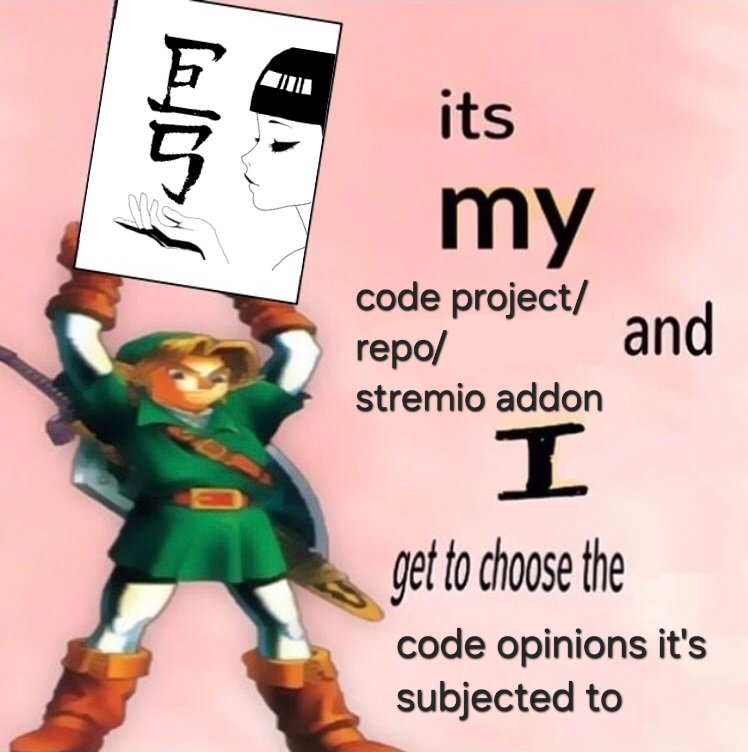

# Before submiting your PR!

Go through this checklist:

- This PR focused on **ONE** change. I didn't change code that is only partially related to the main focus of the PR
- My changes adhere to the conventions laid out in the codebase. I used the functions, abstractions and flows that already exist
- **If I used an LLM (AI):** I did not vibe code/slop this. I read the code. I understand the changes it made. I'm ready to take responsibility for the changes my agent(s) made

If the answer to **ANY** of these is no, please fix it before submiting your PR for review. **The only exceptions** to these that are acceptable are:

- **I'm proposing multiple changes because they all depend on each other:** Separate your changes anyway. Use stacked PRs or rebase your other depending PRs when the "parent" PR gets merged
- **I'm not adhering to the current codebase because I think this approach/syntax/etc is better:** Then open a PR that exclusively refactors the code before this

## Why enforce this?
Well, reallistically speaking, I could just say:

However, I think I have good reasons to ask for these.

I know these measures may seem very strict (versus the "if it works, it works" philosophy), and I'm not a software engineer (although I **have** studied programming in academic institutions), but I do know from general experience, and also my own, that keeping code clean, abstractable, legible, etc. ends up making it way easier to catch future bugs or add new functionallity or features, compared to having to unknot a plate of spaghetti.

Think about it, if each contributor does similar tasks in different ways, maintaining, fixing or adding new functionallity gets very difficult because you'll need to know how each one does it, or re-read it to understand it each time, and it makes it difficult to abstract that behaviour.

I'm thinking about not only my own future, but the future contributor's or possibly yours (or even an LLM's, even if I'm not too keen on churning out sloppy code with AI).
